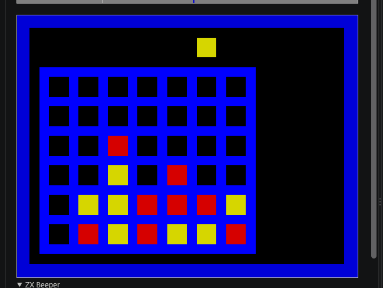

# Connect Four in Z80 Assembly (ZX Spectrum 48K)

Academic project developed for the **Computer Architecture and Organization** course (B.Sc. in Computer Engineering). This repository contains a low-level implementation of the classic **Connect Four** game for the **ZX Spectrum 48K** architecture, written entirely in **Z80 Assembly**.



## Controls
* **Player 1:** `A` / `D` (move left/right), `S` (drop token)
* **Player 2:** `I` / `P` (move left/right), `O` (drop token)

## Key Features
* **Custom Graphics & Board Rendering:** Direct video memory manipulation (`graphics_basic.asm`, `graphics_core.asm`) to render the grid and colored tokens.
* **Configurable Game Rules:** Support for custom board dimensions (`xsize`, `ysize`), variable winning conditions (`N-in a row`), and customizable player colors (`colors.asm`, `game_variables.asm`).
* **Keyboard Input & Turn Flow:** Low-level keyboard polling (`keyboard.asm`) and structured game state loop (`game_logic_flow.asm`).
* **Win & Draw Detection:** Modular verification algorithms (`logic_checks.asm`) checking horizontal, vertical, and diagonal alignments.

## Tech Stack & Environment
* **Language:** Z80 Assembly (`ZXSPECTRUM48` target)
* **Assembler:** `sjasmplus`
* **IDE & Debugger:** Visual Studio Code with the **DeZog** extension

## How to Run
1. Clone this repository:
   ```bash
   git clone https://github.com/LucasTejeraFragoso/Connect4Assembly.git
   ```
2. Open the folder in **Visual Studio Code** with the **DeZog** extension installed.
3. Open `main.asm` and press `F5` (**Run > Start Debugging**) to launch the ZX Spectrum simulator and play.\
**WARNING**: Make sure you are only inside the carpet Connect4Assembly

## Authors & Acknowledgments
* **Project Implementation:** Developed by our student team as coursework for the **Computer Architecture and Organization** course.
* **Starter Code:** Base configuration files and initial helper templates were provided by the course faculty.
